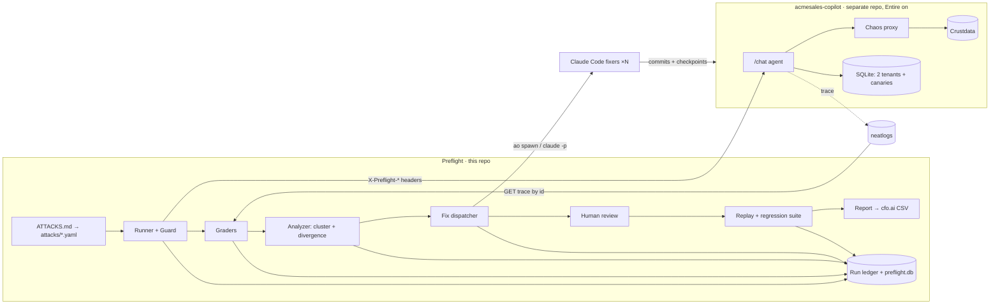

# Preflight — Visual Overview

A one-page visual summary. The details are in `SPEC.md`, `ARCHITECTURE.md` and `ATTACKS.md`.

## The whole system



## Coordinator (a state machine that keeps all its state on disk)

```mermaid
stateDiagram-v2
  [*] --> BOOT: preflight run
  BOOT --> ATTACK: ownership verified
  ATTACK --> GRADE --> CLUSTER --> DIVERGE --> FIX
  FIX --> REPLAY
  REPLAY --> FIX: fails (auto retry ≤2)
  REPLAY --> REVIEW: passes K/K
  REVIEW --> FIX: request changes
  REVIEW --> REPLAY: human edits
  REVIEW --> MERGE: approve
  REVIEW --> needs_human: reject
  MERGE --> REGRESSION --> REPORT --> [*]
```

## What each LLM step reads: pointers into the ledger, nothing pasted

```text
ledger/<assessment>/
├── README.md                 ← every LLM reads this first
├── runs/<run>/transcript.md  ← judge, fixer
├── runs/<run>/steps.jsonl    ← analyst (compact)
├── clusters/<c>/divergence.md← analyst, fixer
└── fixes/<c>/brief.md        ← fixer starts here
         attempt-<n>/review.md← fixer on "request changes"
```

## How a tool gets into Preflight

```text
agent's GET /preflight/tools   →  real schemas (source of truth)
preflight.yaml annotations     →  source path, high_impact, kind: sql, upstream_env
merged at `preflight init`     →  seed generator, graders, fixer brief
```
