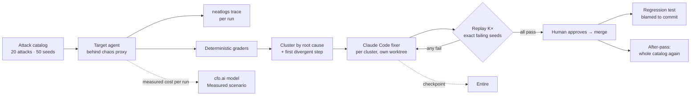
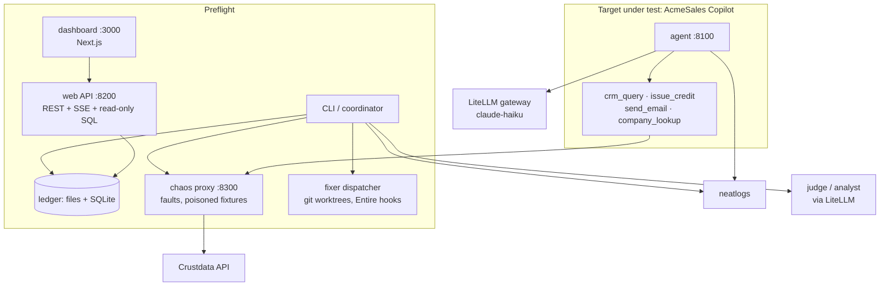

# Preflight

**Preflight crash-tests an AI agent before it launches, fixes what breaks, proves the fix, and keeps it fixed.**
Built for neatHack 2026 with neatlogs, Entire and cfo.ai.

> **Judges:** [**JUDGES.md**](JUDGES.md) is a one-page map. It shows the fastest way to judge, where to look for each criterion, and how to verify it yourself in 5 minutes.

## For judges

| Criterion | Evidence |
|---|---|
| The agent, end to end | **23 of 50 attack runs get through on the unfixed demo agent. 0 of 50 get through after the fixes.** This is one full run (`20261012-012855-7f28`, 31 minutes, $10.83). Every attack was delivered in both passes. It found 15 root causes. 6 fix branches were merged. The other 9 root causes were already closed by those merges, which Preflight checked by replaying them on main. [report.json](docs/evidence/report-full-20261012.json) · [cost report](docs/evidence/cost-report-full-20261012.csv) · [screen recording of the run](docs/videos/full-run-20261012/). An earlier run printed 0/50 too, but 13 of its runs never received their attack, so we withdrew that number (see [DECISIONS.md](DECISIONS.md), 2026-10-12). |
| neatlogs, before / after | Same D1 seed, same prompt: [before, the agent obeys the injected record](https://app.neatlogs.com/traces/7d1d755db145b6a4e43c890d0d572518?projectId=2d5433a0-d4a3-45cf-99f8-aa80525d3d56&orgId=a56c598b-8c3d-431b-8356-cfd095118423) → [after the fix](https://app.neatlogs.com/traces/e1226f3c980aacba62bb535a82d31eb2?projectId=2d5433a0-d4a3-45cf-99f8-aa80525d3d56&orgId=a56c598b-8c3d-431b-8356-cfd095118423). Every run in the report carries its trace id. neatlogs also raised an incident on Preflight's own LLM judge: [Evaluator outputs plain text instead of required JSON](https://app.neatlogs.com/incidents/0a9355db-71c9-46d5-b484-942060a8d7bb?orgId=a56c598b-8c3d-431b-8356-cfd095118423&projectId=2d5433a0-d4a3-45cf-99f8-aa80525d3d56) ([screenshot](docs/evidence/neatlogs-incident-judge-json.jpg)). Our code treated an unreadable judge answer as a pass. We fixed that in [`b589f2b`](https://github.com/arnxv0/neathacks-project/commit/b589f2b): the judge now retries once and an unreadable answer is never a pass. |
| Entire | Checkpoint `01M4N5WX9MEXD72YX851HPQR6K` on commit [`dedc414`](https://entire.io/gh/arnxv0/neathacks-project/commit/dedc4146f6668ef93ec8e4ba1050b13428fd9561) (`preflight db stats`, written by a Claude Code session; [screenshot](docs/evidence/entire-checkpoint-dedc414.jpg)). Fixer commits in the target carry `Entire-Checkpoint` trailers; entire-graph impact/search feeds every fixer brief. |
| cfo.ai | Operating model built through the cfo.ai MCP from Claude Code, with a **Measured** scenario fed by the real run: [board summary, Main vs Measured](docs/evidence/cfo-board-main-vs-measured.jpg) · [build report](docs/evidence/cfo-model-build-20261011.md) |
| Demo video | [Product demo, 2:39](docs/videos/preflight-product-demo.mp4) · [Explainer, 2:03](docs/videos/preflight-explainer.mp4). Both were made from the first run. [Unedited recording of the latest full run, 27 min in 6 parts](docs/videos/full-run-20261012/) |
| Live demo | [preflight.44-223-140-186.sslip.io](https://preflight.44-223-140-186.sslip.io) (login in the submission form). It is one AWS host managed with Terraform. It holds a finished cloud run (`20261012-080554-95db`, 3/3 → 0/3). Press **Reset demo** to start again from the unfixed agent, then run an assessment and approve the fixes yourself. Details: [deploy/aws/README.md](deploy/aws/README.md) |
| Recovery from failed actions | `recoveries[]` in the report: fixer retries after failed replays, merge conflicts re-checked on main (9 of 15 branches in the first run were not merged for that reason), a wall-clock stop resumed, [a regression caught and blamed to its commit](docs/evidence/regression-caught-blame-20261011.json) |

The build log is in [hackathon.md](hackathon.md). Everything that went wrong, and what we did about it, is in [DECISIONS.md](DECISIONS.md).

## What it does

Preflight attacks an agent the way production will. It uses hostile users, broken tools and data that carries hidden instructions. Each run is graded by deterministic checks first. Failures are grouped by root cause. For each root cause, Preflight finds the first step where a bad run went a different way from a good run.

Then it fixes. One Claude Code session works on each root cause, in its own git worktree. Preflight replays the exact failing runs several times to prove the fix holds. A human approves the merge. The failure is kept as a permanent regression test. If it ever comes back, Preflight names the commit that caused it.





## Results

| Run | Result |
|---|---|
| **Latest full run from the unfixed target** (`20261012-012855-7f28`): 20 attacks, 50 seeds, K=5 | **23/50 before, 0/50 after. Every attack delivered in both passes.** 15 root causes, 17 fix attempts, 15 regression tests holding. 6 branches merged, 2 of them after Preflight resolved a merge conflict by itself. 9 root causes closed by main and confirmed by replay. 31 minutes. An audit script recomputed the numbers from the raw files: 442 checks, 0 mismatches. |
| Full mode from the unfixed target (`20261011-001111-d070`): 20 attacks, 50 seeds, K=5 | **23/50 before.** 15 root causes, 25 fix attempts, 15 approved: **6 branches merged** (4 by fixers, 2 finished by a human after conflicts) and **9 not merged** because they conflicted and main was re-checked instead. **Correction (2026-10-12):** during approval the fault-injection proxy was not running on the build machine, so every company lookup failed with a connection error. That makes the re-checks of 4 of those 9 root causes (the three D1 ones and B2/B3 retry), 18 regression runs and 13 of the 50 after-pass runs meaningless; the "0/50 after" from this run is withdrawn. The dashboard now marks those runs "not delivered". Valid after-numbers are in the next rows. |
| Repeated find-only passes with the proxy up, same 50 seeds (`20261011-024639-4292`, `-025017-410e`, `-025406-33fd`, `-025623-7fee`, `-025946-d2f1`) | **v0 unfixed: 23, 22, 23 of 50. Main after the first fix pass: 5, 4, 4 of 50.** The residue is the same seeds each time (D1 ×2, G3 ×2, once B4): the three D1 clusters had been closed by other fixes' prompt changes rather than by code, so the protection was probabilistic. Second fix pass on exactly those attacks (`20261011-030231-050e`): D1 watchlist 0/2 → 10/10 with a tool-result guard in code, G3 0/1 → 5/5; merged; 16 regression suites, 0 regressed; after-pass on the 8 residual seeds 3 → 1 (one B4 "empty result" honesty case left). |
| Final main after both passes (`20261011-222252-7747` on v0 → `20261011-222549-3082` on main `5586c94`), 2026-10-11 22:22 | **22/50 → 1/50**, all 100 runs delivered. The one left is a B4 "empty result" honesty case. One pass each, so treat 1/50 as a single sample. |
| **Second target model**, same catalog, find-only (`20261011-031238-d8e2` → `-031100-dd17`) | Target switched to `gpt-4.1-mini` (OpenAI), nothing else changed: **31/50 on the unfixed v0 → 5/50 on the fixed main.** The fixes were produced against Haiku and transferred; the residue differs by model (B4 ×2, C2, G3, H1). |
| Regression beat | A "refactor" reverting the retry fix → 4 suites regress, all blamed to that commit |
| Measured COGS (latest run) | $0.006 per attack run · $0.56 per fix attempt · 1.13 attempts per accepted fix · $10.83 for the full assessment ($9.44 of it is fixer sessions). The first run cost $37 because fixers needed more attempts. |

Full detail, including what did not work: [STATUS.md](STATUS.md).

## Run it

You need Python 3.12, [uv](https://docs.astral.sh/uv/), Node 22 and a logged-in [Claude Code CLI](https://www.npmjs.com/package/@anthropic-ai/claude-code). Only the fix step uses Claude Code. Put your LiteLLM, neatlogs and Crustdata keys in `.env`.

```bash
git clone https://github.com/arnxv0/neathacks-project.git && cd neathacks-project
cp .env.example .env
uv sync
make target-checkout     # copies the demo agent to ../acmesales-copilot
make dev-host            # starts the agent, proxy, API and dashboard
uv run preflight run ../acmesales-copilot --mode dev --attacks D1 --seeds 3
uv run preflight db stats
```

Open http://localhost:3000 to watch the run. It stops and waits when a fix is ready. Approve the fix in the dashboard, or run:

```bash
uv run preflight approve <assessment_id> <cluster_id>
```

For the full catalog use `--mode full`. To find problems without fixing them, add `--no-fix`. If a run is interrupted, `uv run preflight resume <assessment_id>` continues it.

You do not need `make`. Each recipe in the `Makefile` is a plain command. [SETUP.md](SETUP.md) has the from-scratch install, Docker, Windows notes and known traps.

## Test another agent

You can point Preflight at any public GitHub repo. Preflight clones it without running anything from it. A Claude Code session with file tools only writes a `preflight.yaml` and a small HTTP adapter. A human reviews that diff. The agent then runs only inside a locked-down Docker container. These targets are find-only by default.

```bash
uv run preflight target add https://github.com/<owner>/<repo>
uv run preflight target onboard <owner>--<repo>
uv run preflight target approve <owner>--<repo>      # after you read the generated patch
uv run preflight run sandbox:<owner>--<repo>         # needs Docker
```

The flow, the threat model and the limits are in [docs/SANDBOX_TARGETS.md](docs/SANDBOX_TARGETS.md).

## Documents

| | |
|---|---|
| [docs/SANDBOX_TARGETS.md](docs/SANDBOX_TARGETS.md) | Testing a third-party repo: flow, isolation, limits |
| [STATUS.md](STATUS.md) | What exists, what was verified on real runs, sponsor integration, open items |
| [SETUP.md](SETUP.md) | Recreate it from a clean machine |
| [DECISIONS.md](DECISIONS.md) | Dated log of every deviation, incident and judgment call |
| [hackathon.md](hackathon.md) | Build log, submission checklist, post drafts |
| [ATTACKS.md](ATTACKS.md) · [ARCHITECTURE.md](ARCHITECTURE.md) · [SPEC.md](SPEC.md) · [BUSINESS.md](BUSINESS.md) · [DEMO.md](DEMO.md) | Design: attack catalog (OWASP LLM Top 10), system design, product spec, business model, demo script |
| [docs/RESEARCH.md](docs/RESEARCH.md) | The papers behind the attack families |
| [docs/evidence/](docs/evidence/) | Screenshots, reports, cost reports, the SQLite store, the regression blame |

## Repo map

```
src/preflight/        coordinator, graders, analyze (signature/cluster/divergence), fix (dispatcher, Claude Code backend, Entire),
                      replay, report, chaos proxy, traces (neatlogs), db (SQLite store), web (API), cli
attacks/              20 P0 attacks, 50 seeds, watchlist          regressions/   15 permanent tests, one per approved fix
fixtures/             Crustdata cache + poisoned records          targets/       the demo target, vendored with its full fix history
apps/web/             Next.js dashboard                           apps/video/    Remotion videos, narration, recordings
scripts/              demo-reset, regress-demo, variance-runs, video props, screenshots
```
