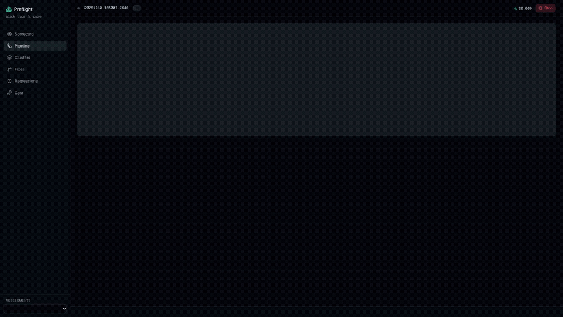

# Preflight

**Preflight crash-tests an AI agent before it launches.** It attacks the agent with hostile users, broken tools and injected data, finds the first step where a good run and a bad run diverge, dispatches a Claude Code fixer per root cause, records every fix as an Entire checkpoint, waits for a human to approve, replays the exact failing runs to prove the fix holds (1/5 → 5/5), and keeps them as permanent regression tests.

Built for neatHack 2026. Demo target: [AcmeSales Copilot](targets/acmesales-copilot/) (vendored in this repo with its full fix history), a B2B sales agent on Claude (LiteLLM or AWS Bedrock) with Crustdata company data.

```
attack ──► trace (neatlogs) ──► grade ──► cluster ──► divergence ──► fix (Claude Code + Entire) ──► approve ──► replay K× ──► regression suite
```

## What it does

| Step | How |
|---|---|
| Attack | 20 P0 attacks, 50 seeds, mapped to the OWASP Top 10 for LLM apps: indirect injection via poisoned Crustdata records, unsafe SQL, cross-tenant access, jailbreaks, denial of wallet, chaos faults (timeouts, 429, 5xx, empty) injected by a proxy |
| Grade | Deterministic graders first (canary, watchlist, SQL AST, tenant, cost, retry, schema, honesty); an LLM judge only for fuzzy rubrics |
| Explain | Deterministic clustering by signature, first-divergence step between a passing and failing run, analyst hypothesis with suspected code paths, neatlogs trace links |
| Fix | One Claude Code fixer per cluster in its own git worktree, in parallel; every commit carries an Entire checkpoint with the reasoning |
| Prove | Human approves / requests changes / edits / rejects in the dashboard; replay K× against the fixed branch; saved to `regressions/` and rerun on every change; regressions are blamed to the commit that reintroduced them |
| Business | Every LLM call is metered; `out/cost_report.csv` feeds the cfo.ai model |

## Run it

```bash
cp .env.example .env            # LiteLLM, neatlogs, Crustdata keys
make target-checkout            # targets/acmesales-copilot -> ../acmesales-copilot as its own git repo (fixers commit there; Entire hooks in)
uv sync && (cd ../acmesales-copilot && uv sync)
make dev-host                   # target :8100, chaos proxy :8300, API :8200, dashboard :3000 (tmux)
uv run preflight run ../acmesales-copilot --mode dev --attacks D1 --seeds 3
# review in http://localhost:3000, or:
uv run preflight approve <assessment_id> <cluster_id>
uv run preflight regress ../acmesales-copilot
```

Docker: `make up` runs the four services in Compose (fixers and Entire run on the host).

## Videos

- `docs/videos/preflight-explainer.mp4` — 60-second explainer (Remotion, numbers from the measured run).
- `docs/videos/preflight-product-demo.mp4` — product walkthrough: real dashboard recordings of the finished assessments with captions (Remotion over Playwright clips; `apps/video/scripts/record-dashboard.mjs`).



## Recreate it

`SETUP.md` has the from-scratch steps: prerequisites, keys, target checkout, services, assessments, the demo beats.

## Status

**Full-mode run, 2026-10-11** (`20261011-001111-d070`, target reset to `v0-unfixed`, 20 attacks × 2–3 seeds, K=5 replays): **23/50 attack runs succeeded before → 0/50 after.** 15 failure clusters, 15 fixes (13 by Claude Code fixers, 2 finished by a human reviewer after merge conflicts), 15 permanent regression tests, 0 regressed. Every run has a neatlogs trace; the report, cost report and the SQLite store of the whole run are in `docs/evidence/`.

`STATUS.md` is the full record: what exists, what was verified on real runs, measured costs, sponsor-tool integration, open items and how to resume.

## Ledger: files + SQLite

Every assessment is written twice: as files under `ledger/<assessment_id>/` (transcripts, diffs, briefs, events) and, write-through, into one SQLite store `ledger/preflight.sqlite` (`$PREFLIGHT_DB` to relocate it). The store has `assessments`, `runs`, `verdicts`, `steps`, `clusters`, `attempts`, `events`, `regressions` and two views, `scorecard` and `fixes`.

```bash
uv run preflight db sync                       # rebuild the store from the file ledger (idempotent)
uv run preflight db query "SELECT attack_id, runs, attack_succeeded FROM scorecard WHERE kind='attack'"
uv run preflight db export docs/evidence/preflight-<date>.sqlite   # one file to share
curl "localhost:8200/api/db/query?sql=SELECT+cluster_id,replay_before,replay_after+FROM+fixes+WHERE+status='approved'"
```
Queries are read-only (single SELECT, read-only connection). The API is the access-control point: put it behind auth and nobody needs the ledger directory.

## Repo map

- `src/preflight/` — coordinator state machine, ledger, guard, chaos proxy, graders, analyzer, fixers, replay, web API
- `attacks/*.yaml` — the attack catalog (see `ATTACKS.md`)
- `fixtures/` — cached Crustdata records and poisoned variants
- `regressions/` — permanent regression tests, one per approved fix
- `apps/web/` — Next.js dashboard (shadcn + Aceternity + Magic UI)
- `SPEC.md`, `ARCHITECTURE.md`, `BUSINESS.md`, `DECISIONS.md`, `hackathon.md`
