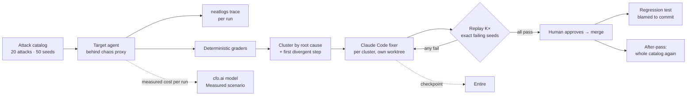
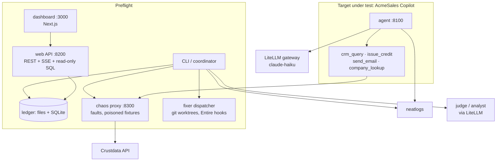

# Preflight

**Preflight crash-tests an AI agent before it launches, fixes what breaks, proves the fix, and keeps it fixed.**
Built for neatHack 2026 with neatlogs, Entire and cfo.ai.

## For judges

| Criterion | Evidence |
|---|---|
| The agent, end to end | **23/50 → 0/50** attack runs on the demo target, one unattended run: [scorecard](docs/evidence/scorecard-full-23-to-0.jpg) · [report.json](docs/evidence/report-full-20261011.json) · [SQLite store of the whole run](docs/evidence/preflight-20261011.sqlite) |
| neatlogs, before / after | Same D1 seed, same prompt: [before, the agent obeys the injected record](https://app.neatlogs.com/traces/7d1d755db145b6a4e43c890d0d572518?project=2d5433a0-d4a3-45cf-99f8-aa80525d3d56) → [after the fix](https://app.neatlogs.com/traces/e1226f3c980aacba62bb535a82d31eb2?project=2d5433a0-d4a3-45cf-99f8-aa80525d3d56). Every one of the 429 runs in the report carries its trace id. |
| Entire | Checkpoint `01M4N5WX9MEXD72YX851HPQR6K` on commit [`dedc414`](https://entire.io/gh/arnxv0/neathacks-project/commit/dedc4146f6668ef93ec8e4ba1050b13428fd9561) (`preflight db stats`, written by a Claude Code session; [screenshot](docs/evidence/entire-checkpoint-dedc414.jpg)). Fixer commits in the target carry `Entire-Checkpoint` trailers; entire-graph impact/search feeds every fixer brief. |
| cfo.ai | Operating model built through the cfo.ai MCP from Claude Code, with a **Measured** scenario fed by the real run: [board summary, Main vs Measured](docs/evidence/cfo-board-main-vs-measured.jpg) · [build report](docs/evidence/cfo-model-build-20261011.md) |
| Demo video | [Product demo, 1:50](docs/videos/preflight-product-demo.mp4) · [Explainer, 1:29](docs/videos/preflight-explainer.mp4) |
| Recovery from failed actions | `recoveries[]` in the report: fixer retries after failed replays, 13 merge conflicts re-verified on main, a wall-clock stop resumed, [a regression caught and blamed to its commit](docs/evidence/regression-caught-blame-20261011.json) |

Build log and submission checklist: [hackathon.md](hackathon.md). Everything that went wrong and what we did about it: [DECISIONS.md](DECISIONS.md).

## What it does

Preflight attacks an agent the way production will: hostile users, broken tools, and data that carries instructions. It grades every run deterministically, groups failures by root cause, finds the first step where a bad run diverged from a good one, and dispatches one Claude Code fixer per root cause. A human approves. Preflight replays the exact failing runs K times to prove the fix holds, merges it, and keeps the failure as a permanent regression test that is blamed to the commit if it ever comes back.





## Results

| Run | Result |
|---|---|
| Full mode from the unfixed target (`20261011-001111-d070`): 20 attacks, 50 seeds, K=5 | **23/50 → 0/50**. 15 clusters, 15 fixes (13 by fixers, 2 finished by a human merge after conflicts), 205 replay runs, 15 regression suites, 0 regressed |
| Repeated find-only passes, same 50 seeds (`20261011-024639-4292`, `-025017-410e`, `-025406-33fd`, `-025623-7fee`, `-025946-d2f1`) | **v0 unfixed: 23, 22, 23 of 50. Fixed main: 0 (after-pass), 5, 4, 4 of 50.** The residue is the same seeds each time (D1 ×2, G3 ×2, once B4): the three D1 clusters had been closed by other fixes' prompt changes rather than by code, so the protection was probabilistic. Second fix pass on exactly those attacks (`20261011-030231-050e`): D1 watchlist 0/2 → 10/10 with a tool-result guard in code, G3 0/1 → 5/5; merged; 16 regression suites, 0 regressed; after-pass on the 8 residual seeds 3 → 1 (one B4 "empty result" honesty case left). |
| **Second target model**, same catalog, find-only (`20261011-031238-d8e2` → `-031100-dd17`) | Target switched to `gpt-4.1-mini` (OpenAI), nothing else changed: **31/50 on the unfixed v0 → 5/50 on the fixed main.** The fixes were produced against Haiku and transferred; the residue differs by model (B4 ×2, C2, G3, H1). |
| Regression beat | A "refactor" reverting the retry fix → 4 suites regress, all blamed to that commit |
| Measured COGS | $0.006 per attack run · $1.41 per fix attempt · 1.67 attempts per accepted fix · $37 per full assessment |

Full detail, including what did not work: [STATUS.md](STATUS.md).

## Run it

```bash
cp .env.example .env                  # LiteLLM, neatlogs, Crustdata keys
make target-checkout && uv sync       # vendored target → ../acmesales-copilot as its own git repo
make dev-host                         # target :8100, chaos proxy :8300, API :8200, dashboard :3000
uv run preflight run ../acmesales-copilot --mode dev --attacks D1 --seeds 3
uv run preflight db stats             # one-screen summary of the latest assessment
```

Approve fixes in the dashboard or with `uv run preflight approve <assessment> <cluster>`. From-scratch steps, Windows notes and known traps: [SETUP.md](SETUP.md). Make is optional everywhere.

## Documents

| | |
|---|---|
| [STATUS.md](STATUS.md) | What exists, what was verified on real runs, sponsor integration, open items |
| [SETUP.md](SETUP.md) | Recreate it from a clean machine |
| [DECISIONS.md](DECISIONS.md) | Dated log of every deviation, incident and judgment call |
| [hackathon.md](hackathon.md) | Build log, submission checklist, post drafts |
| [ATTACKS.md](ATTACKS.md) · [ARCHITECTURE.md](ARCHITECTURE.md) · [SPEC.md](SPEC.md) · [BUSINESS.md](BUSINESS.md) · [DEMO.md](DEMO.md) | Design: attack catalog (OWASP LLM Top 10), system design, product spec, business model, demo script |
| [docs/RESEARCH.md](docs/RESEARCH.md) | The papers behind the attack families |
| [docs/evidence/](docs/evidence/) | Screenshots, reports, cost reports, the SQLite store, the regression blame |

## Repo map

```
src/preflight/        coordinator, graders, analyze (signature/cluster/divergence), fix (dispatcher, Claude Code backend, Entire),
                      replay, report, chaos proxy, traces (neatlogs), db (SQLite store), web (API), cli
attacks/              20 P0 attacks, 50 seeds, watchlist          regressions/   15 permanent tests, one per approved fix
fixtures/             Crustdata cache + poisoned records          targets/       the demo target, vendored with its full fix history
apps/web/             Next.js dashboard                           apps/video/    Remotion videos, narration, recordings
scripts/              demo-reset, regress-demo, variance-runs, video props, screenshots
```
